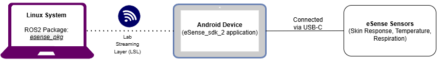

# eSense

- The eSense sensors consists of Skin response, temperature, respiration and pulse sensors.  For more information, refer to the [Wiki](https://git.inf.h-brs.de/zat-rhein-ruhr/zat-prototype-demo/consor/-/wikis/home/eSense/Consor-Vital-Information) page

- This repository is specifically for bridging the [eSense physiological sensors](https://mindfield-esense.com/ )  with the publisher node.

#### Folder Contents

- misc 
The *misc* folder includes screenshots, images etc.

- esense_lsl 
The *esense_lsl* folder includes a ROS2 package (esense_pkg) to publish eSense data to a ROS node using **pylsl**.  The data is transferred from Android Studio to the Linux system using LSL (Lab Streaming Layer).  For more information about installation, usage, etc. refer to the README within this directory.

### Hardware Setup

- The hardware setup for these sensors when transferring data via Lab Streaming Layer (LSL) is as follows:

 
