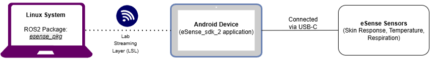

# Introduction

- This repository is specifically for bridging the [eSense physiological sensors](https://mindfield-esense.com/ ) specifically, eSense skin response, temperature and respiration sensor with the publisher node using **pylsl**.

- The hardware setup for these sensors are as follows:

 

- The ROS2 package for publishing eSense sensor data is *esense_pkg*.
- When the data is transferred via **Lab Streaming Layer (LSL)**, then the **esense_pkg** ROS2 package should be used.

# esense_pkg Package

### Requirements/Dependencies

- WiFi connectivity ***(eSense and the Linux System must be connected to the same WiFi/Network)***
- [zat_ros2_msgs](https://git.inf.h-brs.de/zat-rhein-ruhr/zat-prototype-demo/zat_ros2_msgs)
- [pylsl](https://github.com/labstreaminglayer/pylsl)
- [liblsl](https://github.com/sccn/liblsl)
- Either conda environment (for installation of liblsl) or the source code (.deb) for liblsl from the [release](https://github.com/sccn/liblsl/releases) page.

### Tested environment 

- Ubuntu 22.04 + ROS2 Humble
- Python 3.8 or higher
- pylsl (v1.17.6)
- liblsl ([v1.16.2](https://github.com/sccn/liblsl/releases/tag/v1.16.2)) < Requirement for pylsl library

### Installation

- Pylsl: `pip install pylsl`
- Liblsl: Refer to **<<link to esense liblsl installation section in documentation>>** for steps to install liblsl
##### ROS2 packages

- Create a ROS2 workspace using `mkdir -p zat_ws/src` or if a ROS2 workspace already exists use `cd zat_ws/src` 
- In src, add **consor** and **zat_ros2_msgs** repositories. This is included in the **<< link to releases >>**.

### Usage/Steps

##### Steps to run the eSense android application

- Name of the working eSense application: ***eSense_sdk_2*** 
- Open the application on the android device.  
- To test the application, follow the steps:
    - Set the sampling rate (to 1 or 2 Hz for simplicity)
    - Set sensor type to any sensor (If not connected to any sensor, then set the sensor type to a simulator e.g. tempSimulator)
    - Click start sampling.  This should prompt a dialog box asking to allow permissions if not already granted.  If the sampling does not start after granting permission, click start sampling again. 
    - Click stop sampling to stop the sampling. 

##### Steps to run the 'esense_pkg' package

Refer to **<<link to esense documentation section for running the esense_pkg>>** to run the ROS2 package for eSense.

##### Notes

- After ros2 launch, there can be a delay where the system is trying to find the LSL streamer (android device) that streams the sensor data.
- Ensure permissions are provided to the android application.
- Ensure that the application starts sampling first before running the ROS node. 
    - This is because, on clicking 'Start Sampling', the application initiates and starts streaming the data using LSL. 
    - The ROS node is a receiver script for the data streamed by the LSL streamer. 
    - Hence, the application needs to start streaming the data before the ROS node script can find and receive this streamed data. 

##### Troubleshooting

If there are any problems, try troubleshooting. Refer to troubleshooting section in the << **link to documentation** >>.
